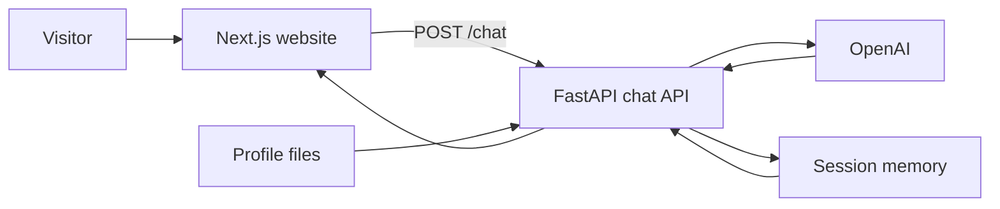

A digital twin is a small website where visitors talk to an AI that represents you. The model only knows what you put in a few files: facts, a short summary, how you want to sound, and your LinkedIn profile saved as a PDF.

The finished project is two apps:

- A Next.js website
- A FastAPI chat API that calls OpenAI `gpt-4o-mini`

On the [LaxAIHub portfolio](https://www.laxaihub.com/portfolio) the website is embedded in a page, the same way as the other live projects.

<CardGroup cols={2}>
  <Card title="Source" icon="github" href="https://github.com/laxaihub/digital-twin">
    Private repository with the website, the API, and the longer build notes.
  </Card>
  <Card title="Live twin" icon="message-circle" href="https://www.laxaihub.com/lax-digital-twin">
    The portfolio page that embeds the deployed website.
  </Card>
</CardGroup>

## Architecture



On each message the API builds a system prompt from the profile files, sends that prompt plus the conversation to OpenAI, and saves the thread so the next reply remembers what was said.

## What you need

- Python 3.12 or newer. This project pins Python 3.14.
- Node.js 20 or newer. This project uses Next.js 16.
- An [OpenAI API key](https://platform.openai.com/api-keys)

## Folder layout

```text
digital-twin/
  backend/
    server.py
    context.py
    resources.py
    requirements.txt
    .env
    data/
      facts.json
      summary.txt
      style.txt
      linkedin.pdf
  frontend/
    app/
    components/twin.tsx
  memory/
```

`memory/` is created when the API runs. Do not commit it. Do not commit `.env`, `backend/.venv`, or `frontend/node_modules`.

## Add your profile

Put these files in `backend/data`.

| File | What it is |
| --- | --- |
| `facts.json` | Name, role, location, and specialties. Valid JSON, with no trailing comma. |
| `summary.txt` | A few paragraphs about the work, in your own words. |
| `style.txt` | How the twin should sound. |
| `linkedin.pdf` | The LinkedIn profile saved as a PDF. The API reads the text. Visitors never see the file. |

`facts.json` looks like this. Replace the values with your own.

```json
{
  "full_name": "Your Name",
  "name": "Your first name",
  "role": "Security Architect",
  "location": "Ontario",
  "specialties": ["Identity", "Cloud security"]
}
```

<Warning>
Save the Python and JSON files as code only. If a sample is shown inside a Markdown fence, do not copy the fence lines into the file. A fence at the top of `facts.json` or `resources.py` makes the API fail on startup.
</Warning>

## Load the files

`backend/resources.py` reads the four files from the folder next to itself, so the API can find them no matter which directory you start it from.

```python
from pathlib import Path
from pypdf import PdfReader
import json

DATA = Path(__file__).resolve().parent / "data"

try:
    reader = PdfReader(DATA / "linkedin.pdf")
    linkedin = ""
    for page in reader.pages:
        text = page.extract_text()
        if text:
            linkedin += text
except FileNotFoundError:
    linkedin = "LinkedIn profile not available"

with open(DATA / "summary.txt", "r", encoding="utf-8") as f:
    summary = f.read()

with open(DATA / "style.txt", "r", encoding="utf-8") as f:
    style = f.read()

with open(DATA / "facts.json", "r", encoding="utf-8") as f:
    facts = json.load(f)
```

`backend/context.py` turns those values into the system prompt. `prompt()` includes the facts, the summary, the style notes, the PDF text, and the current time. It tells the model to speak as the person, stay professional, and not invent facts that are not in the files.

## Wire the prompt into the chat

Creating those two files does not change the chat until `server.py` uses them. The system message on `POST /chat` must be the profile prompt:

```python
from context import prompt

messages = [{"role": "system", "content": prompt()}]
```

Then append the saved conversation and the new user message, call `gpt-4o-mini`, and write both sides back to `memory/`.

Locally, memory lives next to the project. On Vercel the filesystem is read-only except `/tmp`, so the API uses that when `VERCEL` is set:

```python
if os.getenv("VERCEL"):
    MEMORY_DIR = Path("/tmp/twin-memory")
else:
    MEMORY_DIR = Path(__file__).resolve().parent.parent / "memory"
```

`backend/requirements.txt` for this project is:

```text
fastapi
uvicorn
openai
python-dotenv
python-multipart
pypdf
```

After adding `pypdf`, update the lockfile from the `backend` folder with `uv add pypdf` if you use `uv`. A host that installs from `uv.lock` will not install a package that is missing from the lock.

## Run the API

From `backend`:

```bash
python -m venv .venv
.venv\Scripts\activate
pip install -r requirements.txt
copy .env.example .env
```

`.env` needs two values:

```text
OPENAI_API_KEY=sk-your-key
CORS_ORIGINS=http://localhost:3000
```

`CORS_ORIGINS` is the website address allowed to call the API. For a deployed site, add that public address after a comma. The API uses credentials, so the origin cannot be `*`.

```bash
uvicorn server:app --reload --port 8000
```

Open `http://localhost:8000/health`. You should see `{"status":"healthy"}`.

`POST /chat` accepts `{ "message": "hello", "session_id": null }` and returns the reply plus a `session_id`. Send that id on the next message to continue the same conversation.

<Note>
If the twin says the LinkedIn profile is not available, the PDF was not found. If startup fails with a JSON error, remove the trailing comma in `facts.json`.
</Note>

## Run the website

From `frontend`:

```bash
npm install
npm run dev
```

Open `http://localhost:3000`. The page calls `http://localhost:8000` unless `NEXT_PUBLIC_API_URL` is set:

```typescript
const API_BASE = process.env.NEXT_PUBLIC_API_URL || "http://localhost:8000";
```

The sun and moon control switches light and dark mode. The choice is saved in the browser. Dark mode is a near-black navy with a blue accent.

## What happens on one message

<Steps>
  <Step title="The visitor asks">
    They type a question, or tap a suggested question.
  </Step>
  <Step title="The website calls the API">
    The page sends the text to `POST /chat` with the current session id.
  </Step>
  <Step title="The API builds the prompt">
    It loads earlier messages, then sends the profile prompt, the history, and the new question to OpenAI.
  </Step>
  <Step title="The reply is saved">
    Both sides of the exchange are written to that session file, and the reply is shown in the chat. Bold Markdown in the reply is rendered, not shown as raw asterisks.
  </Step>
</Steps>

## Deploy

Deploy the API and the website as two apps. The portfolio then embeds the website.

<Steps>
  <Step title="Deploy the API">
    Host `backend` where Python can run. Set `OPENAI_API_KEY` and `CORS_ORIGINS`. Include `http://localhost:3000` and the public website address.
  </Step>
  <Step title="Deploy the website">
    Set `NEXT_PUBLIC_API_URL` to the public API address before the site is built. Next.js bakes that value in at build time.
  </Step>
  <Step title="Embed it">
    On the portfolio site, add a card that opens a page with an iframe pointed at the deployed website.
  </Step>
</Steps>

This project is deployed as:

- Website: `https://lax-digital-twin.vercel.app`
- API: `https://lax-digital-twin-api.vercel.app`
- Portfolio page: `https://www.laxaihub.com/lax-digital-twin`
